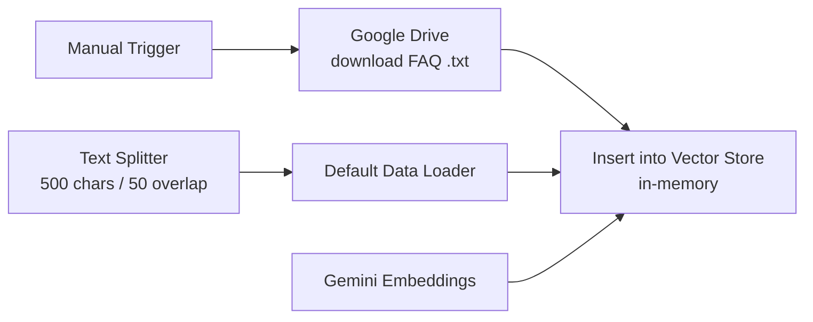
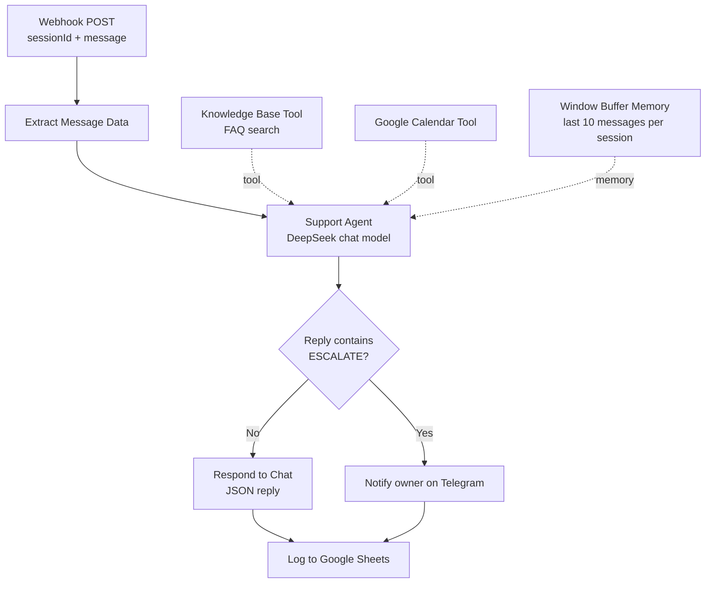

# AI Support Agent: RAG + Booking (Web Chat)

An n8n workflow that powers a website chat assistant for a company. It answers customer questions from a company FAQ (Retrieval-Augmented Generation), checks a Google Calendar for free consultation slots, remembers the conversation per visitor, **escalates to a human via Telegram** when it isn't sure, and logs every conversation to Google Sheets.

The demo company in the sample FAQ is "AutoFlow Solutions". Replace it with your own business.

<!-- TODO: add a screenshot of the workflow canvas and a GIF of the chat widget -->
<!--  -->
<!--  -->

## Architecture

The workflow has two independent flows on one canvas.

**1. Knowledge ingestion (run manually when the FAQ changes)**



**2. Chat (runs on every message)**



### How a message is handled

1. The chat widget sends a `POST` request to the webhook with a JSON body containing `sessionId` and `message`.
2. **Extract Message Data** maps them to `userId` and `messageText`.
3. The **Support Agent** (DeepSeek chat model) answers under a strict system prompt:
   - look up the FAQ tool before answering anything about prices, working hours or policies, and never invent information
   - for booking requests, check the calendar for free slots between 09:00-11:00 and 14:00-16:00, Monday to Friday
   - when unsure, or when the customer asks for a real person, end the reply with the exact marker `[ESCALATE]`
   - reply in the customer's language (Vietnamese or English), briefly and in a friendly tone
4. **Window Buffer Memory** keeps the last 10 messages per `sessionId`, so the conversation has context.
5. **Check Escalation** looks for the `[ESCALATE]` marker:
   - **No marker:** the answer is returned to the chat as `{ "reply": "..." }`.
   - **Marker found:** the owner gets a Telegram message with the customer ID, the customer's message and the AI's draft answer.
6. Every conversation is appended to a Google Sheet (phone/session, message, AI response, escalated flag, timestamp).

## Tech stack

| Component | Role |
|---|---|
| [n8n](https://n8n.io) | Workflow orchestration |
| DeepSeek Chat | LLM for the support agent |
| Google Gemini Embeddings | Embedding FAQ chunks and queries |
| n8n in-memory vector store | Stores FAQ embeddings for retrieval |
| Google Drive | Source of the FAQ text file |
| Google Calendar | Checking availability for consultations |
| Google Sheets | Conversation log |
| Telegram Bot | Human escalation alerts |
| `chat-widget.html` | Front-end chat widget that calls the webhook |

## Setup

1. **Import** the workflow JSON into n8n.
2. **Create credentials** and attach them to the matching nodes: DeepSeek API, Google Gemini (PaLM) API, Google Drive OAuth2, Google Calendar OAuth2, Google Sheets OAuth2, Telegram Bot API.
3. **Prepare your data:**
   - Upload your FAQ as a `.txt` file to Google Drive and select it in the *Google Drive - Download FAQ* node.
   - Create a Google Sheet with the columns `Phone`, `Message`, `AI Response`, `Escalated`, `Timestamp` and select it in the *Log Conversation* node.
   - Select your calendar in the *Google Calendar Tool* node.
   - Put your own Telegram chat ID in the *Notify Owner (Telegram)* node.
4. **Load the knowledge base:** run the *Manual Trigger* once. This downloads the FAQ, splits it, embeds it and stores it in memory.
5. **Configure the webhook:** in the *Webhook* node, set the response mode to "Using 'Respond to Webhook' Node" and replace the sample path with a hard-to-guess one.
6. **Connect the widget:** set the webhook URL in `chat-widget.html`, activate the workflow and open the page.

Request and response format:

```json
// POST <your-n8n-url>/webhook/<path>
{ "sessionId": "visitor-123", "message": "What are your working hours?" }

// 200 response
{ "reply": "..." }
```

> No API keys are stored in the workflow file. Credentials are referenced by internal ID only and must be re-created in your own n8n instance. Before publishing, replace personal identifiers (Telegram chat ID, Google Sheet, Calendar and Drive file IDs) with placeholders.

## Evaluation

<!-- TODO: fill in with your own test results -->

| Test case | Expected behavior | Result |
|---|---|---|
| Price / hours / refund question covered by the FAQ | Accurate answer from the FAQ | |
| Question not in the FAQ | `[ESCALATE]` and Telegram alert | |
| "I want to talk to a person" | `[ESCALATE]` and Telegram alert | |
| Booking request | Suggests free slots within the allowed windows | |
| English and Vietnamese messages | Reply in the same language | |
| Follow-up question in the same session | Uses earlier context | |

## Design decisions

- **Grounded answers.** The agent must search the FAQ before answering about prices, hours or policies, which reduces made-up information.
- **Explicit escalation marker.** A fixed token makes the human-handoff decision easy to detect and test.
- **Per-visitor memory.** Conversation memory is keyed by `sessionId`, so different visitors never share context.
- **Observability.** Every exchange is logged with an escalation flag, which makes it possible to review quality and measure the escalation rate.
- **Ingestion separated from chat.** Updating the FAQ does not touch the chat flow.

## Known limitations and next steps

- **Booking is read-only.** The calendar tool is configured to list events only, so the agent can find free slots but cannot create the event. Add a second Google Calendar tool with the *Create event* operation to complete the booking.
- **No reply on escalation.** In the escalation branch the visitor receives no message. Add a *Respond to Webhook* node there with a polite "a team member will contact you" message.
- **The vector store is in memory.** The FAQ embeddings are lost when n8n restarts, so the ingestion flow must be re-run. For production, use a persistent store such as Pinecone or Qdrant.
- **Logging relies on auto-mapping.** Map the log fields (session, message, reply, escalated, timestamp) explicitly so that every column is filled correctly.
- **Webhook protection.** Add authentication (for example a header token) and rate limiting before exposing the webhook publicly.
- **Channel wording.** The system prompt mentions WhatsApp while the flow is a web chat. Align the wording or add a WhatsApp trigger.

## Repository structure

```
.
├── README.md
├── ai-support-agent-webchat.json   # exported n8n workflow
├── chat-widget.html                # web chat front-end
└── assets/                         # screenshots / demo GIF
```

## License

MIT (or choose your own).
